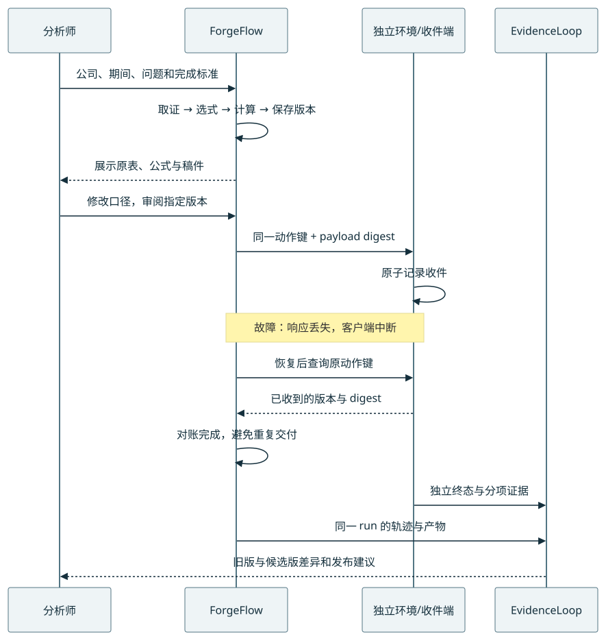

# 从可核验的年报任务到 Agent 评测闭环

## ForgeFlow、EvidenceLoop 与 HorizonBench 的模块化设计、开发实验和人机协作排期

**中文技术研究报告 · 版本 0.1 · 2026-11-23**

本文采用研究论文的组织方式，报告可定位到源码和原始运行记录的工程实验，并给出尚待验证的集成设计。它不是已经完成大规模泛化验证的模型研究结论。图中实线表示冻结快照已有的实现或离线连接，虚线表示在途或计划连接；“实现存在”和“同一次业务运行已经验收”分别标注。

## 摘要

企业 Agent 的错误可能发生在不同层：检索找到了相关表，但把季度当成年；模型选对分子分母，却计算出错误百分比；报告已提交，但回执丢失使客户端重复发送。如果只检查最终回复或总成功率，这些错误可能被混为同一种“模型效果不好”。本报告以企业年报研究为共同任务，将系统分为业务执行层 ForgeFlow、评测与改进层 EvidenceLoop、环境与独立终态层 HorizonBench。我们整理了确定性期间与公式实验、14 条评分器开发观察、两组各 12 次真实模型调用，以及 4 种策略乘 3 种故障的收件回执实验。结果说明：明确业务口径、程序计算和原幂等键对账分别修复不同类型的问题，但不能互相替代；部分方案同时带来修好和退化。当前三个项目已通过冻结记录形成离线证据连接，完整共享运行号的业务闭环仍待联调。最后，我们用具有人工窗口、并行执行槽与本地模型互斥资源的排程模型，分别估算人工参与、后台工作量和日历周期，替代此前混合工时的估计。

**关键词：** Agent Harness；年报问答；独立终态；数据谱系；幂等；配对评测；人机协作。

## 1. 问题与研究范围

### 1.1 从一个完整委托出发

设分析师提出：比较 Apple 两个财年的服务收入变化，并说明服务收入增量解释了公司总收入增量的多少。系统需要完成以下过程：确认公司和财年，找到可对齐的原始单元格，区分增长率与增长贡献，执行计算，形成带引用的稿件，接受分析师修改口径，对指定版本进行审阅，提交报告，最后确认收件方确实收到正确版本且没有重复。

用户修改问题不是附加的聊天体验。例如将“全年经营现金流”改为“第四季度经营现金流”，会改变期间、候选单元格和最终答案；保留旧数字继续完成报告会构成业务错误。服务恢复也不是“重新跑一遍”即可：提交超时既可能表示没有送达，也可能表示已经送达但响应丢失。

本项目的离线完成条件是：指定报告可打开；公司、期间、单位、指标与公式有证据；报告版本与批准版本一致；独立收件端恰好保存规定数量的正确报告；运行轨迹、产物摘要和评分均能追溯到同一个委托。真实用户收益、企业流量和医疗专家有效性需要另外的试用或领域研究，不由这个离线条件替代。

### 1.2 四个研究问题

- **RQ1：语义与计算。** 如何区分证据缺失、期间错配、公式选错和算术错误，使改动针对真正的失败环节？
- **RQ2：评分可信度。** 如何防止“答案看起来合理”“有引用”或 Agent 自报完成骗过评测？
- **RQ3：长任务可靠性。** 状态交接、工具失败和回执丢失后，如何验证恢复到正确终态且不重复产生副作用？
- **RQ4：交付时间。** 当 Agent 可全天运行、操作者每天只参与有限时间时，如何区分人工负担与最终交付周期？

## 2. 先把术语与责任说清楚

|术语|在这个系统里的意思|不能与什么混同|
|---|---|---|
|LLM|根据当前输入生成回答或选择动作的模型|模型选择动作不代表动作已经执行成功|
|Tool calling|模型提出结构化工具名和参数，程序校验后调用实际函数|不等于任意 shell 权限，也不等于每次都必须用 MCP|
|Agent Harness|接收输入、组织上下文、调度工具、控制预算和保存状态的运行框架|它的程序逻辑与模型权重是两种可改进对象|
|Orchestration|规定步骤、分支、等待、重试和交接由谁执行|多个模块不自动等于多个 Agent|
|RAG|检索证据并给生成或计算提供上下文|检索命中不等于答案口径正确|
|Trace|可观察的模型请求/响应、工具动作、结果和状态事件|不要求获取模型未公开的内部思维链，也不是事实金标|
|Checkpoint|某次运行可恢复的状态快照|不等于跨任务长期知识或自由文本总结|
|Benchmark|任务、输入、环境、参考证据与评分规范组成的版本化测试集|不只是错题列表或一张分数表|
|Grader / verifier|执行具体检查并返回分项结果的程序或评审过程|不能只依赖被测 Agent 的自报结果|
|Outcome|运行结束后环境中实际形成的状态|不等于聊天里说“已完成”|
|Idempotency|对同一业务意图的重试保持约定的副作用语义|换一个键重试通常是新的意图，不自动防重复|
|Post-training|实际更新模型权重并对训练后的模型复测|生成训练数据、修改 prompt 都不是已经完成后训练|

任务、trial、轨迹、评分器和环境结果的区分参照 Anthropic 的 Agent 评测实践 [R1]；本报告据此将业务执行、环境核验和版本评价分开。持久化检查点与跨会话存储的区别可对照 LangGraph 文档 [R2]。这里借鉴的是职责与验证方法，不表示需要把现有项目全部换成某一框架。

## 3. 相关工作：借鉴什么，保留什么边界

|原始资料|可借鉴的设计|本项目的适用边界|
|---|---|---|
|FinanceBench [R3]|财报问题同时保存答案和证据，使用人工复核|公开题适合建立开发样例；不能把见过的题再包装成独立锁测|
|FinQA [R4]|数值推理不仅记录最终答案，也记录可解释的计算程序|本项目将操作数、公式和单位显式保留，但未声称复现 FinQA 全集结果|
|ReAct [R5]|动作与外部观察交替更新后续行动|D18 目前仅诊断一次动作选择与执行，尚不等于完整循环|
|τ-bench [R6]|用会话结束后的数据库状态核对目标，并关注重复尝试可靠性|这里的收件状态是相同思想的局部工程实现，不继承其基准分数|
|LLM-as-a-Judge [R7]|评审模型可能存在位置、长度等偏差，需要与人类判断比较|确定性财务事实不交给 judge 凭印象打分，开放项才进入校准流程|
|AWS 幂等重试实践 [R8]|用调用方提供的意图键重试，并校验相同键是否对应同一请求|本地实验验证特定故障；键保留期限、网络分区与生产吞吐仍需另测|
|DPO 原论文和 TRL [R9][R10]|偏好数据与实际优化过程是训练证据链的一部分|先解决证据与执行路径问题；有可靠同上下文偏好对后再考虑 DPO|

以上资料支持问题分解与实验设计，不构成当前系统已经生产成熟的证明。

## 4. 总架构与当前连接


**图1说明。** ForgeFlow 负责做事，HorizonBench 负责提供可控失败环境并独立查结果，EvidenceLoop 负责比较版本。当前 EvidenceLoop 已导入固定来源的 4 条 ForgeFlow 问答和 12 条 HorizonBench 回执；这是离线归档连接。三者还没有围绕同一份实际交付报告共同跑出完整的共享运行结果。

将它们拆成三个仓库，有利于分别测试业务规则、故障语义和评测方法。代价是接口和版本管理必须明确。此时不需要三个仓库各自维护一套通用 Agent runtime，也不应让业务系统自己宣告自己的输出必然正确。

|边界|拥有者|输入|输出|主要不变量|
|---|---|---|---|---|
|业务执行|ForgeFlow|委托、身份、文档、修订要求|可审阅稿件、动作与产物|取数口径明确；批准绑定版本；副作用受控|
|环境与终态|HorizonBench|任务快照、动作、故障、最终产物|独立断言与回执|检查外部实际状态；保留重复、未知与故障原因|
|评测与改进|EvidenceLoop|任务、参考证据、运行包、回执|逐题差异与版本决策材料|不混合样本类型；同条件比较；开发集不冒充锁测|
|最终业务判断|操作者/审阅人|证据、候选方案、实验结果|接受、退回或调整要求|本人确认的是可见依据，不能补写不存在的历史判断|

## 5. ForgeFlow：业务任务怎样变成可交付结果


### 5.1 文档、检索与回答路径

**文档接入 `pdf_ingest.py`。** 输入是本地公开 PDF 和来源清单。模块提取页、表、行、单元格文本与页面位置，并保留来源摘要。输出不仅是字符串，还包括能够回到原页的证据位置。PDF 更新后，旧引用不能默认继续有效；来源校验失败时应停止使用旧结果。

**检索 `retrieval.py`。** 输入问题和访问身份，输出排序后的证据候选。词法检索适合精确术语和数值，向量检索帮助语义匹配；融合后仍需要业务口径检查。模型不可用时退回词法属于降级模式，应对 UI 可见。新文档的增量解析、缓存复用与 rerank 的完整性能实验仍属于后续验证，不能由当前四份年报推断千份规模结果。

**查询编排 `report_desk.py`。** 它连接提问、来源、检索和回答路径。对于已经覆盖的精确财务问题，可走确定性模块；其他问题进入受证据约束的模型回答。图中两个分支不是“先让模型猜、再一律覆盖”，而是不同的执行路径。确定性实验的模型调用数为零，必须单独报告。

**期间核对 `annual_cash.py`。** 它不是通用金融理解模型，而是将指标、年度列、单位与重复披露的规则显式化。输出包含被选中的值和证据；年度无法证明时返回 `PERIOD_UNVERIFIED`，多处合格证据冲突时保留候选并等待核查。硬性要求两处来源会提高拒答范围，不是免费的质量提升。

**计算工具 `apple_sales.py`。** 它接收已对齐的原格与业务公式，输出操作数、计算结果和引用。服务收入增长率与服务对公司收入增长的贡献率使用相同分子，却使用不同分母。程序能消除执行层算术错误，但不能替代对业务公式和目标财年的判断。

**模型回答 `cited_answer.py`、`answerability.py`。** 该路径使用本地模型、结构化回答与引用约束。存在页码并不证明该页支持该结论。历史季度错配正说明答案检查需要覆盖期间、单位和原格关系，而不仅是引用格式。

### 5.2 服务、运行和研究稿模块

|已有模块或目标设计|输入与处理|输出/失败处理|冻结快照状态|
|---|---|---|---|
|`desk_service/gateway.py`|接收请求；缓存、去重、限流/背压；提交任务|已缓存结果、joined/queued、429/503 等状态|已有实现，不能等价于生产负载验收|
|Redis|保存缓存、去重及运行事件等服务状态|复用结果、查询运行进度|已有服务结构；不将其误写为全部消息队列|
|RabbitMQ 与 worker|消息队列将任务交给 `desk_service/worker.py`|执行、失败事件、重试和最终结果|已有代码及部分恢复记录|
|gRPC retrieval|worker 请求检索服务|候选证据或检索错误|已有实现和局部回归|
|SSE / `ReportDesk.tsx`|把运行状态和结果送到浏览器|进度、回答、页码和原页预览|已有问答 UI|
|研究证据 API（目标模块）|由已核结果形成 evidence，检查来源与引用版本|证据快照或来源改变/不可验证状态|不属于本文冻结代码；目标职责|
|稿件版本存储（目标模块）|保存稿件、版本、摘要和修订事件|草稿、提交、退回、批准、交付状态|不属于本文冻结代码；待实现/验收|
|稿件审阅界面（目标模块）|分析师和审阅人操作指定稿件版本|修改、批准、下载和交付结果|目标界面；不是企业 SSO 已完成|

### 5.3 稿件状态和业务安全

建议状态路径是 `draft → submitted → returned/approved → delivered`。修改内容生成新版本；批准必须绑定稿件版本和内容摘要，而不是只绑定一个可变文档 ID。若批准后内容改变，应使原批准不再适用于新内容。并发修改需要版本冲突提示，不能静默覆盖另一人的修改。

本机 author/reviewer 身份可以验证角色分离和流程，但不能冒充企业 SSO、电子签章或合规认证。当前阶段先验证业务不变量，再根据真实部署需要扩展身份服务。各次写操作应保留动作键、参数摘要和回执，为 HorizonBench 的独立读取提供依据。

## 6. EvidenceLoop：怎样知道新版本更好


### 6.1 数据、评分与实验模块

|模块|实际代码或目录|输入|负责什么及输出|
|---|---|---|---|
|数据构建|`data/build.py`|原始任务与来源|构造样本并保留数据版本；不把生成样本自动当人工金标|
|样本选择|`data/selection.py`|候选样本与规则|选择数据、组织开发/训练/测试；新年报域仍需按文档族落实切分|
|旧域运行框架|`harness/`|模型、工具、输入|产出可观察轨迹，为既有实验提供运行基础|
|年报事实评分|`report/annual.py`|回答、数值、单位、来源|对硬要求作检查，区分错误与证据不足|
|逐题比较|`report/compare.py`|多个方案的记录|组织对照结果；完整分组统计协议仍需后续落实|
|证据条件实验|`report/evidence_trials.py`|同一题的不同证据输入|保存真实模型请求与响应，观察证据改变影响|
|工具计算实验|`report/calculation.py`|模型动作与实际计算回执|保留操作数、公式、结果和参考值比较|
|离线比较页|`reports/report-lab/review.html`|上述归档与外部来源记录|让人逐题看修好、退化、未知及外部收件|
|盲评材料（目标模块）|不属于本文冻结代码|隐藏方案身份的样本|在途复核入口；生成表单不等于已有独立人工标注|
|训练模块|`train/`|示范、偏好及训练配置|旧域有训练评估报告；新年报训练结论待完成|

### 6.2 错误记录、评测集与评分器的关系

错误出现时，应立即保存原始输入、工具动作、响应、版本和环境状态，进入失败队列。随后先确认事实与责任环节，再决定是否纳入开发集、回归集或训练候选。未经复核的报错不能直接变成永久正确答案；否则评分器会把旧误判固化。

对一个回答可以同时存在多个分项判断。例如数值正确、单位错误、引用支持程度未知。系统应保留这些分项和未完成的取证，而不是急于压成一个无法解释的总分。若独立证据读取超时，记录系统取证失败和暂时无法判断；已经发现的数值冲突仍然有效，不会被“还在等待”抹掉。

硬事实先用程序检查：公司、期间、单位、数字、公式、版本、收件数量。开放项如报告是否清晰、是否覆盖委托重点，使用明确 rubric；LLM judge 只作为辅助，并需要盲评和人工对照。既有研究记录了 judge 的位置与长度等偏差 [R7]，所以不能让它成为所有正确性的唯一来源。

### 6.3 同条件比较与数据污染

候选版和基线版应面对相同任务、来源版本与预算。先按公司和文档族切分，再生成变体，避免相邻表格或重复披露跨到训练与测试两端。开发题已经用于改 prompt 或工具后，就继续留在开发集，不再称为未见测试。

逐题报告四类变化：两版都通过、修好、退化、两版都未通过；另保留未知和系统错误。总准确率不能说明某类严重错误是否增加。正式不确定性估计需要根据数据依赖选择重抽样单位；同一财报的多道变体不能假设完全独立。当前只有少量公开开发问题，不输出具有总体推断含义的显著性结论。

### 6.4 从评测走到训练

优先定位输入证据、工具接口和执行逻辑。如果模型拿不到表头，先修证据；如果公式正确而除法错误，先验证程序计算；如果在正确证据与工具下仍稳定选错语义，才讨论训练。SFT 需要可靠示范和权重产物，DPO 需要同上下文可复核的偏好对，GRPO 等方法还需要可信奖励与可重置环境。

这不是“应用层修不动就只能换基座”的二分法。输入表示、工具抽象、上下文组织、解码约束、模型选择和权重训练都是不同干预点。DPO 的数据与训练要求可参照原论文和 TRL 实现 [R9][R10]。训练后必须重新检验未见题、工具使用、遗忘、成本和完整业务结果。

## 7. HorizonBench：长任务失败后怎样验收


### 7.1 环境与执行者分开

环境保存真实状态并执行动作；执行者只能看到允许的工具观察。这样可以测试执行者是否根据正确观察作出行动，而不是把金标直接给它。旧反应釜任务提供连续控制与长时程基线；新的年报任务分别关注回执语义和修订后的口径交接。它们共享可靠性问题，但当前代码不是一条所有场景都已统一验收的产品链。

|模块|代码位置|职责与输入/输出|失败与边界|
|---|---|---|---|
|年报交接环境|`env/annual_handoff.py`|输入任务、事件与交接模式，输出受限观察|目标期间或审阅备注丢失要被独立发现|
|回执实验|`receipt.py`|执行四策略三故障，保存过程与 verdict|明确区分未送达、已送达但响应丢失|
|执行者|`agents/`|输入观察和预算，选择动作|确定性策略与真实模型结果分别报告|
|运行器|`runner.py`|推进回合、预算、循环/陈旧观察检查|记录终止原因，不把预算耗尽当成功|
|持久化|`store.py`|保存状态、事件、检查点与轨迹|进程重启后要能找到待处理意图|
|领域规则|`family.py`|定义任务族的规则与判定适配|不能把一个领域的真值规则硬套另一领域|
|独立 verifier|`verifier.py` 与场景判定逻辑|读取实际状态和事件，输出分项断言|不依赖 Agent 的“我完成了”|
|报告|`report.py` 与实验输出目录|汇总运行、结果和复跑 manifest|标明样本、种子、环境与证据类型|

### 7.2 为什么超时不能直接等价于失败

发送请求、服务端落库、返回响应是不同事件。超时只说明客户端没有得到期望响应。恢复策略应首先查询原业务意图键的实际状态；若已经收到且内容摘要匹配，则对账完成；若未收到，则按原意图重试；若同键对应不同内容，应拒绝并处理冲突。这与幂等 API 中用请求标识保留语义的做法一致 [R8]。

本地收件箱验证的是约定的不变量，而不是一般意义上的分布式 exactly-once 定理。跨系统事务、键过期、长期网络分区、收件端不支持查询等情形，需要额外方案和实验。保留“待人工确认”可以是正确且诚实的安全状态，但与“无人值守成功交付”必须分开统计。

### 7.3 检查点、交接记忆和审阅人原话

D002 环境包含两种相反的口径修改：全年改季度，以及季度改全年。比较最近一条、最近三条、完整历史和结构化口径卡片。终态验收检查期间、金额、单位、来源页、审阅备注是否保留以及实际工具读取；token 和耗时另外记录为成本指标，不属于这份环境的通过/失败断言。

结构化卡片的优势是假设它能减少噪声并保留关键约束；风险是提取器遗漏或写错事实。完整历史保留信息更多，但不保证模型会注意到最新修改。因此不能只比较 token 多少，而要比较相同任务下的终态。冻结快照有实验环境和预登记，尚不在本文报告哪种模型记忆策略最好。

## 8. 接口与一次完整运行

### 8.1 建议的最小交换对象

以下对象是目标契约说明，不宣称冻结快照已经统一使用这些字段名。

|对象|最小字段|拥有者与用途|
|---|---|---|
|TaskSpec|case_id、公司、期间、口径、预算、任务版本|业务方定义什么算完成|
|EvidenceClaim|文档摘要、页/格、单位、期间、值、公式、提取版本|ForgeFlow 提供可检查事实|
|RunBundle|run_id、case_id、attempt、模型/提示/工具版本、动作、产物引用|让评测能对应到一次实际运行|
|ArtifactManifest|artifact_id、revision、digest、source_refs、approval_ref|防止批准版本与交付版本混淆|
|VerificationReceipt|run_id、environment_version、checks、收件、实际状态、未知原因|HorizonBench 对外提供独立检查结果|
|EvaluationResult|case_id、run_id、grader_version、分项结果、成本、差异|EvidenceLoop 组织比较与决策|

时间戳用来排序，但不能代替版本和因果关系；内容摘要用来识别变更，但不能证明内容事实正确。来源指纹能够发现输入变了，仍需要原表和独立判定说明其语义。

### 8.2 目标顺序图



图5是待联调的目标流程。ForgeFlow 提供同一份已审阅报告；HorizonBench 对真实提交边界注入故障并读取独立收件；EvidenceLoop 使用这次运行的同一标识进行比较。现有离线导入已经为此提供结构与案例，但尚不等价于这张顺序图已经完整跑通。

## 9. 实验方法、结果和可解释性

### 9.1 代码与证据冻结点

|项目|冻结提交|本文采用的主要记录|
|---|---|---|
|ForgeFlow|`206339470a53907fb7041bbb99001ea9bb38f682`|年度现金流、Apple 收入计算及其决策记录|
|EvidenceLoop|`0a650f7d1de9b21d97c3c3e4ac421c195283ac54`|D16、D17、D18、跨项目离线证据接入|
|HorizonBench|`2df6cad415925966cddd5af2f9929f4c72d16a23`|D001 收件故障实验、D002 交接环境|

三个项目继续开发。研究稿、盲评和后续真实模型运行等在途变化，不自动计入上述冻结点。实现与推荐由开发记录说明，独立操作者判断另外记录，不能把 AI 代做选择改写成操作者过去亲自决策。

### 9.2 期间与公式：确定性开发实验

|CATL 目标年度|只按指标行取首格|匹配年度列与单位|再强制两处披露|
|---|---:|---:|---|
|2025|32,868,257|133,219,982|通过|
|2024|32,868,257|96,990,345|通过|
|2023|32,868,257|92,826,124|待核|
|2022|32,868,257|待核|待核|

单位为原年报人民币千元。首格对照将季度页放在前面，以暴露排序与口径风险。历史模型曾选该表末格 `52,559,552`，不能把历史模型错误与本次首格程序当成同一生成路径。上述实验均无模型调用，只覆盖已定义的公开开发任务。

Apple FY2025 计算使用服务收入 109,158、上年服务收入 96,169、公司收入 416,161、上年公司收入 391,035，单位均为百万美元。服务增量为 12,989，公司增量为 25,126。因此服务收入增长率为 13.51%，服务对公司增量的贡献为 51.70%。FY2024 贡献为 141.54%；超过 100% 可能意味着其他部分抵消了增长，并不自动违法数据规则。

### 9.3 评分器、证据和计算三层诊断

|实验|样本与执行方式|观察结果|能说明什么|
|---|---|---|---|
|D16|14 条开发观察，含历史回答与人工反例|宽松引用检查漏放 6 条确定错误|评分口径需要独立事实；不是模型错误率估计|
|D17|4 题 × 3 种证据输入，12 次真实模型调用|补表头修复年度题；计算错误仍存在|输入表示是一个真实干预点|
|D18-A|4 题，直接回答|1/4 数值与引用同时通过|记录基线，样本极小|
|D18-B|4 题，模型选原格后程序计算|2/4 通过，另有原本正确题退化|程序正确执行也可能忠实执行错误分母|
|D18-C|4 题，模型选业务公式和年份|3/4 通过，仍错选年份|支持下一轮优先试业务工具，不支持总体最优结论|

D18 每题一次模型调用，各臂使用相同模型和推理上限，但提示形式有意不同；它是比较完整干预方案，不是假装只有某一个 token 发生变化的纯单变量实验。工具在归档动作上实际执行，结果没有再送回模型继续反思，因此不能称为端到端多步 Agent 成功率。

D18 三臂模型墙钟合计分别约为 19.394、31.975、27.585 秒。它们是这批推理请求的实测时间，不是写好软件、判断业务口径或完成开发项目所需的时间；排期不能从这些秒数直接外推。

### 9.4 收件回执故障矩阵

|策略|正常确认|请求未写入|写入后回执丢失＋进程中断|
|---|---|---|---|
|假定成功|完成，1 份|错误：0 份却自报完成|完成，1 份|
|等待人工|完成，1 份|待确认，0 份|待确认，1 份|
|换新键重试|完成，1 份|完成，1 份|错误：2 份重复报告|
|查询原键再对账|完成，1 份|完成，1 份|完成，1 份|

每格保存过程和独立 verdict；回执丢失场景包含真实 SIGKILL。该矩阵证明不同失败位置要求不同恢复依据，也显示相同总分可能隐藏不同业务风险。它是受控策略实验，不是从生产分布随机采样的可靠率。

### 9.5 已接入与仍缺失

EvidenceLoop 已导入 4 条产品问答和 12 条收件记录，保留来源指纹与源提交链接。导入器实际固定的是 ForgeFlow `e195a0a2f764d30e2d1b5be8a131ceeef95d4b71` 与 HorizonBench `c69eb0ef2a32a45eef8057ab7ebd3065e8cc7f88`；它们是本文代码快照的祖先提交，所引用的现金流和回执 manifest 在较新冻结点内容相同。导入版本与报告盘点版本因此分别记录，不宣称它们来自同一次运行。但跨项目完整业务贯通运行数仍为零。人工盲评材料在推进，真实独立复核不能由生成表单代替。旧域有九个 LoRA 的报告；本轮有限检查未找到本机完整权重，且新年报域没有训练收益结论。

## 10. 关键架构取舍

|决策|已比较或已知依据|当前选择及代价|后续可推翻它的证据|
|---|---|---|---|
|一处明确披露还是强制两处|CATL 2023 被强制双来源误拒|允许明确单处；多处若冲突则待核|单处抽取错误频繁且无法被其他检查发现|
|自由回答、原格表达式、业务工具|D18 有修好也有退化|优先试业务工具并显式检查年份|新任务类型覆盖不足或选择错误更严重|
|单 Agent 还是多 Agent|目前问题可由明确模块和工具表达|先保留可控执行链；多 Agent 作为可比实验|分工能在同预算下改善独立任务结果|
|检查完整历史还是口径卡片|D002 环境已准备，结论尚无|保留四种交接方式，先实测|同任务终态、备注保留与成本对照|
|重交还是先对账|D001 证明新键可导致重复|持久化原意图并先查回执|收件方不支持可靠查询，需要新的协议|
|程序评分还是 LLM judge|事实与开放质量不是同一类对象|程序判硬事实，开放项经校准|标注分歧提示规则覆盖不足|
|先修工程还是训练|缺表头、算术、年份错误来源不同|先做小成本干预对照，再决定训练|正确输入和执行下仍有稳定可学习错误|

“列出十个选项、筛选三到四个实测”适用于影响结果的核心决策。没有必要对每个按钮颜色或日志字段都运行十组实验。记录被排除方案的原因，并让后续数据能够推翻暂定选择，比一次性宣布唯一最佳架构更有价值。

## 11. 人工、后台执行与日历排程

### 11.1 三种时钟和计算假设

人工参与只计操作者需要完成的需求裁定、标签复核、方案选择、验收和讲解；Agent 主动执行计编程、测试、调试与整理；模型资源时间计本地实验调用。三类资源可以部分并行，不能相加成“你必须投入多少小时”。日历时间由依赖和资源可用窗口计算，不由总工时直接除以三个 Agent 得出。

下面是从本文冻结基线出发的三种**替代性交付范围**，不是三个顺序阶段，工时不相加。完整离线范围已经包括面试联动能力。估计由任务分解产生，没有声称是历史实测。既有文档整理正在本报告交付，实际执行时应扣除已验收项并重新排程。

默认：操作者每天 09:00–11:00、19:00–21:00 共 4 小时；三个隔离 Agent 执行槽可全天运行；Mac 本地模型只允许一条实验通道；每天均可用；以 15 分钟推进依赖图。起点 2026-11-23 09:00 只是可重复的模拟原点，下面使用相对天数，不是实际交付日期承诺。

|从当前基线达到的范围|操作者参与|Agent 主动执行|本地模型资源|模拟日历时间|
|---|---:|---:|---:|---:|
|整理已有成果并讲清边界|4–7 h|5–9 h|0–0 h|1.04–2.08 天|
|可面试的三项目联动演示|15–27 h|36–66 h|1–4.75 h|3.46–7.08 天|
|完整离线应用与评测作品集|36–62 h|81–141 h|11.75–45.75 h|8.5–15.5 天|

“Agent 主动执行小时”是所有实施任务的资源工时总和；并行会缩短经过时间，但不会把总工作量消掉。此模型将每项任务归入一个主要资源，没有拟合 Mac 的内存争用、热降频、API 限流、上下文耗尽或共享文件冲突。原始数据不是置信区间；所有低估计同时成立与所有高估计同时成立构成两个规划情景。三槽也不代表三个 Agent 可以共同修改同一个工作区，应使用明确的独立仓库/工作树和接口边界。

### 11.2 面试联动版的每项工作

|工作包|主要执行者|主动时间|完成后留下什么|
|---|---|---:|---|
|确定一条年报委托、完成标准与跨项目契约|操作者|2–4 h|case/run/version/artifact/digest/receipt；包括从十种方案挑三至四种做低成本对照的判断。|
|ForgeFlow：两期查数、公式、稿件和可追溯 UI|Agent|10–18 h|复用已有年报表、确定性计算与研究工作台。|
|EvidenceLoop：冻结 12 个开发题、标签与失败分类|操作者|5–8 h|需要你裁定任务定义、金标、未知项和污染边界。|
|EvidenceLoop：评分、比较页和版本决策卡|Agent|6–11 h|规则、回执和 UI；不把训练写成已完成。|
|同条件模型对照：证据、公式与工具调用|本地模型|1–4.75 h|108 次单步调用：12 题 × 3 方案 × 3 重复。D18 的 12 次实际调用共约 79 秒；这里按每次 20–120 秒加 15–60 分钟冷启动/重试预算，15 分钟向上取整。Mac 本地模型单通道；不含 Agent 改代码时间。|
|复核修好、退化、未知与成本|操作者|3–5 h|决定候选版是否推进，不用平均数掩盖退化。|
|HorizonBench：扩展回执故障环境与独立判定|Agent|7–12 h|可与 ForgeFlow 功能开发并行，先在稳定任务契约上构建环境。|
|HorizonBench：接入真实提交入口与原键对账|Agent|4–8 h|把既有 4×3 受控矩阵接到真实业务产物。|
|审阅回执故障结果与恢复策略|操作者|2–4 h|确认什么叫送达、正确版本和无重复。|
|统一 run、产物摘要、评分和回执的展示|Agent|5–9 h|三项目消费同一条业务任务，但各自保留职责。|
|盲走一次完整委托与修复|Agent|4–8 h|执行、故障、恢复和回归；不算外部用户试用。|
|本人验收、取舍复盘与面试讲解|操作者|3–6 h|你能说明两种以上已试方案、结果和边界。|

### 11.3 完整离线范围的每项工作

|工作包|主要执行者|主动时间|主要依赖|
|---|---|---:|---|
|统一协议、任务族与发布标准|操作者|4–7 h|冻结基线|
|ForgeFlow：取证、两期比较、公式与冲突恢复|Agent|15–27 h|统一协议、任务族与发布标准|
|ForgeFlow：稿件、版本、审批和一次性交付|Agent|18–32 h|ForgeFlow：取证、两期比较、公式与冲突恢复|
|EvidenceLoop：任务族切分、标签、双复核设计|操作者|12–20 h|统一协议、任务族与发布标准|
|EvidenceLoop：混合评分、校准、统计与回归页|Agent|18–30 h|EvidenceLoop：任务族切分、标签、双复核设计|
|多文档族同条件模型实验|本地模型|1.5–8.25 h|EvidenceLoop：任务族切分、标签、双复核设计|
|人工复核、版本决策与实验解释|操作者|7–12 h|EvidenceLoop：混合评分、校准、统计与回归页；多文档族同条件模型实验|
|HorizonBench：五类故障环境与独立判定|Agent|12–20 h|统一协议、任务族与发布标准|
|HorizonBench：真实接口、恢复与回执联调|Agent|8–14 h|ForgeFlow：稿件、版本、审批和一次性交付；HorizonBench：五类故障环境与独立判定|
|记忆/恢复策略配对实验与报告|本地模型|10.25–37.5 h|HorizonBench：真实接口、恢复与回执联调|
|独立终态与长任务策略验收|操作者|5–9 h|记忆/恢复策略配对实验与报告|
|联通 Trace、artifact、receipt 与可演示界面|Agent|10–18 h|人工复核、版本决策与实验解释；独立终态与长任务策略验收|
|留出任务、性能记录与本人答辩复盘|操作者|8–14 h|联通 Trace、artifact、receipt 与可演示界面|

### 11.4 模型时间不能拍脑袋估计

D18 的 12 次实际调用，三臂模型 wall time 合计约 79 秒；它是小题、当次模型和当次机器状态的观察，不是任何新任务都能保持的吞吐。计划采用显式工作负载：

- 面试版：12 题 × 3 方案 × 3 次 = 108 trial；每个单步 trial 20–120 秒，另加 15–60 分钟冷启动与请求重试预算，向上量化到 15 分钟后为 1–4.75 小时。
- 完整离线的单步部分：24 题 × 3 方案 × 3 次 = 216 trial，同一时长假设下为 1.5–8.25 小时。
- 完整离线的多步部分：8 场景 × 3 策略 × 3 次 = 72 trial；每个完整 trial 包含多步工具交互，按 8–30 分钟加 30–90 分钟初始化预算，得到 10.25–37.5 小时。

这些题量和 trial 时长是可调整的实验预算，不是现有结果。多步时间尤其需要先跑一个 pilot 校准；可在 `schedule/tasks.json` 修改 `model_workload` 的题量、方案、重复和时长。模型响应错误导致的代码修复仍记在 Agent 工时，不混入纯模型运行。

### 11.5 操作者参与窗口如何改变日历

|每天个人投入|面试联动范围|完整离线范围|
|---|---:|---:|
|2 h|7.04–13.46 天|17.46–31.04 天|
|4 h|3.46–7.08 天|8.5–15.5 天|
|8 h|2.12–3.29 天|4.38–9.29 天|

在当前依赖图、每天 4 小时窗口下，将 Agent 从一个增至三个没有缩短面试版关键路径：标签冻结、结果复核、最终验收仍决定下一阶段何时开始。这只是该任务图的结果，不代表并行没有作用。实际执行可以前置准备独立任务，积累下一窗口可审阅的结果，减少串行等待；操作者只在有具体选择或验收材料时参与。

### 11.6 可复算方式与未计入条件

```bash
python3 schedule/schedule.py --self-test
python3 schedule/schedule.py --scope interview --human-hours 4 --agent-workers 3
python3 schedule/schedule.py --scope complete --human-hours 8 --agent-workers 3
```

脚本同时检查依赖顺序、人工窗口、资源并发上限和午夜开始时间。它使用固定排序的离散调度，不保证全局最优；任务之间的资源竞争和新的失败会改变实际日程。电脑通电并不自动保证 Agent 会连续执行 24 小时，仍需要任务可继续、服务可用、预算充足和权限满足。

训练是条件附加项：需要可靠标签、可用权重/GPU和额外预算。它不是上述“完整离线应用与评测作品集”的既成部分。第二位独立审阅者、企业数据授权、真实用户试用及线上业务观察都是外部依赖，尚无确定等待时长，不能藏在一个承诺的结束日期里。


## 12. 验收、能力迁移与研究有效性

### 12.1 三个层次的验收

工程验收检查程序是否按契约运行；产品验收检查使用者是否能完成有价值的任务；人工最终判断关注需求、风险和可接受取舍。三者互相提供信息，但不应把“用户尚未复盘讲透”当成另一个独立工程修改不能保存的理由。

|项目|最小可验收结果|进一步成熟的证据|
|---|---|---|
|ForgeFlow|同一委托从原表到可审阅稿件和正确版本交付|新文档/新口径、权限隔离、性能与真实分析师试用|
|EvidenceLoop|同题旧版和候选版的修好、退化、未知与代价可复查|锁测、独立复核、judge 校准、不确定性与线上关联|
|HorizonBench|故障后独立确认正确产物和收件数量|更长任务、真实模型、多次尝试及更多失败位置|
|三项目|共享 case/run/版本/摘要的一次真实运行能串起全部记录|多份完整委托重复运行，故障、回归和版本更新均可追踪|

### 12.2 能迁移到哪些职责

这套结构直接支撑应用层 Harness、企业 Agent、财报信息处理和 Agent 评测中的需求定义、工具设计、trace、状态恢复、版本比较与实验分析。算法研究岗位还需要独立的训练和模型能力证据；vLLM/SGLang 或 GPU 性能要求需要对应引擎上的运行结果；医疗领域还需要专家标签与领域规则；Coding Agent 需要陌生代码仓库修改和测试的任务族。不能将名词覆盖数量解释为岗位匹配概率。

|岗位强调的能力|现有可核查证据|本项目继续补到什么深度|仍需额外证据|
|---|---|---|---|
|评测集与失败归因|D16 评分反例、D17 证据对照、D18 计算对照|按来源族切分，固定金标与失败类别，保留数据版本|独立复核、足够样本与污染检查|
|混合评分与 LLM judge|硬数值/单位/引用/终态判定|明确 rubric，交换候选顺序，和人工判定校准|不能用生成的盲评表冒充完成校准|
|评测促进改进|同题三方案有修好也有退化|修复→回归→锁测→版本决策记录|真实用户收益及线上关联|
|后训练算法|旧域训练报告可查，新域尚未训练|从稳定语义错误构造示范或偏好对，回归完整任务|可加载权重、真实训练日志、未见题提升|
|Harness / 工具调用|查询路由、队列、确定性工具和模型路径|多步行动与观察、预算、检查点、失败恢复|新的完整多步模型运行和受控比较|
|RAG 与上下文工程|PDF 原格、权限检索、混合检索、期间错配案例|证据粒度、rerank、修订口径、长上下文对照|跨文档族召回和成本基准；千份规模未证明|
|生产服务化|FastAPI、队列、worker、gRPC、SSE 等代码|可观察性、背压、恢复、幂等和并发版本验收|线上负载、SLO、安全与实际部署经验|
|vLLM / SGLang|本地模型调用不能替代这些引擎经验|按岗位需要另外接入一个实际引擎并测吞吐/延迟|GPU/平台、批处理和显存优化实验|
|多 Agent 编排|多个仓库和工具不等于多 Agent|在明确任务分工下和单 Agent 做同预算比较|协作收益、通信成本、冲突与失败传播证据|
|长任务可靠性|D001 收件故障；D002 交接环境|重复中断、口径修改、状态恢复与独立终态|更多场景、多次 trial 与真实模型泛化|

这张表用于确定学习和实验的下一步，不把关键词覆盖率当录用概率。评测岗位更关注评分可信度和改进证据；Harness 岗位更关注运行系统、上下文和恢复；偏后训练的算法岗位还需要模型权重层的实证。完整离线作品集可以证明一部分方法能力，但不是全部岗位条件已经满足。

### 12.3 有效性限制

当前样本少且已公开用于开发，不能估计总体效果；同一财报的多个问题相关，不能当独立样本随意增加显著性；人工反例、脚本基线、真实模型调用和故障模拟必须分开计数；模型提示、量化、预算和工具可用性可能改变结论。未来需要按公司和文档族冻结测试、完成独立复核、明确失败成本，并记录发布前后的实际业务变化。

系统也尚未证明能够全天无人值守连续开发。电脑通电、Agent 活跃、模型服务可用和任务可继续是不同条件。上下文、权限、预算、依赖故障与待决策问题可能暂停工作。排程应显示这些条件，而不是把 24 小时当作已经实现的稳定利用率。

## 13. 结论与下一步

现有实验显示了三个不同层次的可修复问题：事实口径、执行计算和提交恢复。三个项目的合理组合，是让业务执行保留证据，让环境独立确认结果，再用版本化评测选择改进。当前重点是统一一次实际任务的标识与产物，将离线证据连接推进到真实业务联调；随后扩大未见任务和人工复核，最后依据稳定错误决定是否进入训练。

对于学习者，每个阶段应能回答五个问题：服务谁；输入和输出是什么；失败发生在哪里；为什么选择这个实现；什么结果会让我改变判断。实际对照记录、原始回执和可运行代码共同支持这些回答，不能由事后编造的设计叙述替代。

## 附录 A：按模块阅读源码

路径相对对应仓库根目录；下列链接固定到本文快照。

- ForgeFlow：[查询编排](https://github.com/langju123456/forgeflow/blob/206339470a53907fb7041bbb99001ea9bb38f682/src/forgeflow/report_desk.py)、[PDF 接入](https://github.com/langju123456/forgeflow/blob/206339470a53907fb7041bbb99001ea9bb38f682/src/forgeflow/pdf_ingest.py)、[检索](https://github.com/langju123456/forgeflow/blob/206339470a53907fb7041bbb99001ea9bb38f682/src/forgeflow/retrieval.py)、[年度期间](https://github.com/langju123456/forgeflow/blob/206339470a53907fb7041bbb99001ea9bb38f682/src/forgeflow/annual_cash.py)、[收入计算](https://github.com/langju123456/forgeflow/blob/206339470a53907fb7041bbb99001ea9bb38f682/src/forgeflow/apple_sales.py)。
- EvidenceLoop：[评分和实验说明](https://github.com/langju123456/evidenceloop/tree/0a650f7d1de9b21d97c3c3e4ac421c195283ac54/docs/report-lab)、[年报模块](https://github.com/langju123456/evidenceloop/tree/0a650f7d1de9b21d97c3c3e4ac421c195283ac54/src/evidenceloop/report)、[原始结果](https://github.com/langju123456/evidenceloop/tree/0a650f7d1de9b21d97c3c3e4ac421c195283ac54/reports/report-lab)。
- HorizonBench：[收件实验](https://github.com/langju123456/horizon-bench/blob/2df6cad415925966cddd5af2f9929f4c72d16a23/src/horizon_bench/receipt.py)、[交接环境](https://github.com/langju123456/horizon-bench/blob/2df6cad415925966cddd5af2f9929f4c72d16a23/src/horizon_bench/env/annual_handoff.py)、[回执结果](https://github.com/langju123456/horizon-bench/tree/2df6cad415925966cddd5af2f9929f4c72d16a23/reports/receipt-experiment)。

推荐阅读顺序：先读业务案例和图1，再选一个项目看内部图与职责表，接着读其原始实验，最后回到接口和排期。读完一个模块后，用自己的话说明它不应该负责什么，并改一个输入预测输出，再复跑验证。

## 附录 B：复跑入口与证据边界

先检出附录 A 的提交并按各项目 README 准备环境。公开 PDF 由来源清单验证，仓库不需要重复分发完整 PDF。本报告没有重新运行这些模型实验，而是核对冻结提交及其原始记录。

```bash
# ForgeFlow：在对应仓库根目录，用已校验的公开 PDF 目录复算。
# 先将 PDF_DIR 设为本机已有的公开年报目录；输出用新路径，保留历史结果。
PYTHONPATH=src python3 scripts/annual_cash_dev.py "$PDF_DIR" /tmp/annual-cash-new.json
PYTHONPATH=src python3 scripts/apple_sales_dev.py "$PDF_DIR" /tmp/apple-sales-new.json

# EvidenceLoop：按保存的响应重评分，以下两条不采样新模型。
PYTHONPATH=src python3 -m evidenceloop.cli report score-evidence \
  --log reports/report-lab/evidence-trials-v1.jsonl

# EvidenceLoop：离线重放归档的计算动作并评分
PYTHONPATH=src python3 -m evidenceloop.cli report score-calculation \
  --log reports/report-lab/calculation-trials-v1.jsonl

# HorizonBench：在新输出目录重做确定性回执故障矩阵
hb receipt-experiment --output /tmp/receipt-new-run
```

重新采样模型会产生新 trial，不能覆盖旧原始结果后继续称为同一次实验。每次修改需保留输入、代码、模型和 grader 版本。若未实际复跑，应明确说正在阅读历史结果。

## 参考文献

- **[R1]** Anthropic. 2026. [Demystifying evals for AI agents](https://www.anthropic.com/research/demystifying-evals-for-ai-agents). 工程实践资料。
- **[R2]** LangChain. [LangGraph Persistence](https://docs.langchain.com/oss/python/langgraph/persistence). 官方实现文档，访问日期 2026-11-23。
- **[R3]** Islam, P. et al. 2023. [FinanceBench: A New Benchmark for Financial Question Answering](https://arxiv.org/abs/2311.11944).
- **[R4]** Chen, Z. et al. 2021. [FinQA: A Dataset of Numerical Reasoning over Financial Data](https://aclanthology.org/2021.emnlp-main.300/). EMNLP。
- **[R5]** Yao, S. et al. 2023. [ReAct: Synergizing Reasoning and Acting in Language Models](https://arxiv.org/abs/2210.03629). ICLR。
- **[R6]** Yao, S. et al. 2024. [τ-bench: A Benchmark for Tool-Agent-User Interaction in Real-World Domains](https://arxiv.org/abs/2406.12045).
- **[R7]** Zheng, L. et al. 2023. [Judging LLM-as-a-Judge with MT-Bench and Chatbot Arena](https://arxiv.org/abs/2306.05685). NeurIPS Datasets and Benchmarks。
- **[R8]** Featonby, M. [Making retries safe with idempotent APIs](https://aws.amazon.com/builders-library/making-retries-safe-with-idempotent-APIs/). Amazon Builders’ Library。
- **[R9]** Rafailov, R. et al. 2023. [Direct Preference Optimization: Your Language Model is Secretly a Reward Model](https://arxiv.org/abs/2305.18290). NeurIPS。
- **[R10]** Hugging Face. [TRL DPO Trainer](https://huggingface.co/docs/trl/dpo_trainer). 官方实现文档，访问日期 2026-11-23。
- **[R11]** GitHub. [Creating diagrams](https://docs.github.com/en/get-started/writing-on-github/working-with-advanced-formatting/creating-diagrams). 架构源码使用 Mermaid，另提供 SVG 便于打印与离线阅读。
