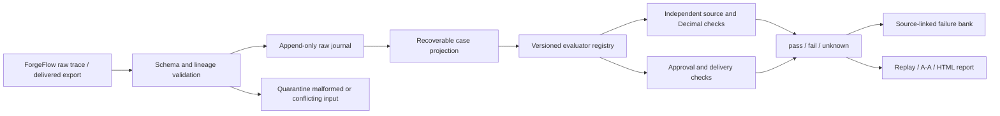

# Native ForgeFlow export evaluation

This is a separate offline path for a real `forgeflow.research.export.v1` JSONL
export (or a `forgeflow.report.trace.v1` JSONL). It does not import ForgeFlow
Python code, call a model, or reuse the simulator verifier.



```bash
PYTHONPATH=src python -m evidenceloop.cli report native-ingest \
  --input /path/to/forgeflow-export.jsonl --store /tmp/native-store
PYTHONPATH=src python -m evidenceloop.cli report native-evaluate \
  --store /tmp/native-store --casebank casebank.jsonl --out /tmp/native-results.json
PYTHONPATH=src python -m evidenceloop.cli report native-replay \
  --store /tmp/native-store --casebank casebank.jsonl --out /tmp/native-replay.json
PYTHONPATH=src python -m evidenceloop.cli report native-aa \
  --store /tmp/native-store --casebank casebank.jsonl --out /tmp/native-aa.json
PYTHONPATH=src python -m evidenceloop.cli report native-mine \
  --results /tmp/native-results.json --out /tmp/native-failures.json
```

`native-ingest` always appends the raw record to `raw.jsonl`. Accepted traces
are deduplicated by `trace_id` plus canonical digest in `cases.jsonl`; a changed
record with the same ID, incomplete line, malformed trace, or invalid input/output
digest is quarantined and never becomes an accepted case. This is restart-safe.
For one logical trace, a bare trace may be followed by its first matching
authoritative export; both raw envelopes are retained and the export is used for
delivery evaluation. A later export is quarantined as `competing_export` (or as
`trace_export_digest_collision` when its nested trace differs). Corrections must
use a new product run, never silently overwrite an accepted export.

The casebank is JSONL with one unique `case_id` per row (it may be an empty
file for the two fixed real product cases). It declares expected
value, unit, period, source observations, valid citation row IDs, and a `read`,
`sum`, `ratio`, or `growth` Decimal calculation. The evaluator recomputes it from the
trace's hit observations; it checks output citations belong to those hits and
keeps missing evidence or evaluator exceptions as `unknown`. The JSON output has
the full checks and source/event IDs; the adjacent HTML file is a readable view.
`native-aa` creates two different evaluation run IDs and only reports exact
comparability over a nonempty common source-ID denominator.

For the shipped product cases, `native-product-v1` also understands the
ForgeFlow report-plugin shape directly: the Apple raw report row is parsed to
recompute both growth and contribution, while the CATL annual row must identify
the annual `千元` table and 2025 column. A quarterly value therefore cannot pass
as the annual amount merely because it appears in another hit.

The native adapter adapts Manus Q7's incremental JSONL ingestion, trusted
evaluator-registry, and failure-bank ideas to ForgeFlow's actual typed
annual-report trace/export contract. It does not import Q7's Watchtower UI or
claim that Q7 supplied the annual-report tool. It verifies local artifacts only;
it does not establish model quality, production adoption, user outcomes, or
facts absent from supplied source observations and the independent casebank.
